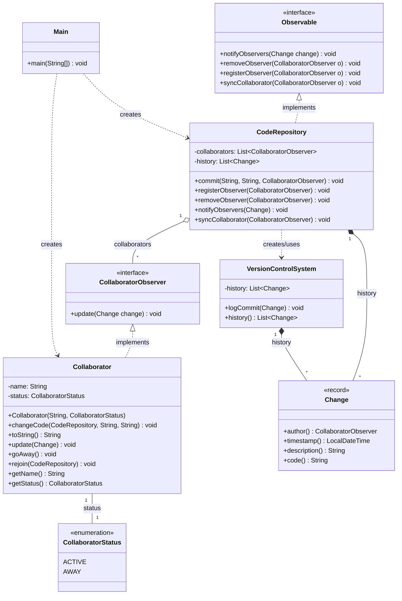

# NOOP - Vježba (Observer Pattern & Version Control System)

Projekt prikazuje primjenu **Observer (Promatrač)** obrasca na primjeru sustava za praćenje izmjena koda u skladištu (`CodeRepository`), uz bilježenje povijesti u `VersionControlSystem`.



## 2. Detaljna obrazloženja zahtjeva (Fokus na Observer uzorku)

### Zahtjev 3: Subjekt (CodeRepository) i registracija promatrača

CodeRepository djeluje kao Observable. U sebi čuva listu registriranih suradnika koji implementiraju CollaboratorObserver sučelje.
Pozivom metode registerObserver() novi suradnik se dodaje u listu preplatnika te dobiva sve buduće obavijesti o izmjenama koda.
Metoda syncCollaborator() omogućuje ponovno sinkroniziranje suradnika koji se vratio u aktivno stanje.

### Zahtjev 4: Promatrač (Collaborator) i sigurna update() metoda

Collaborator implementira CollaboratorObserver sučelje i njegovu update(Change change) metodu.

Sigurnosni mehanizam od kružne izmjene: Unutar update() metode ugrađena je zaštita:
```java
Java
if (change.author().equals(this)) {
    return;
}
```

Ako je suradnik sam autor napravljenog commita, obavijest se ignorira kako se ne bi ponovno okidao vlastiti kod ili stvarale beskonačne petlje obavještavanja.
Pri promjeni stanja putem goAway(), suradnik mijenja status u AWAY, dok kroz rejoin() vraća status na ACTIVE i ponovno se prijavljuje u skladište.

### Zahtjev 5: Notifikacijski mehanizam (notifyObservers)

Kada bilo koji autor pozove changeCode(...), CodeRepository kreira novi Change objekt (s opisom, vremenskom oznakom, novim kodom i autorom).
Nakon spremanja u lokalnu povijest i u VersionControlSystem, poziva se notifyObservers(change).
CodeRepository prolazi kroz listu svih aktivnih observira i svakom poziva update(change), čime se izmjene u realnom vremenu propagiraju svim ostalim članovima tima.

## 3. Službena podjela posla

## 3. Službena podjela posla

Projekt je izrađen u paru (Eli Puljiz i Samuel Puljiz) dijeljenjem koda preko GitHuba. Rad svakog člana vidljiv je u službenoj povijesti commitova:

### Eli Puljiz (`epuljiz`)
* **Inicijalizacija i struktura projekta:**
  * Postavljanje osnovne strukture projekta, paketa (`pckg_model`, `pckg_observer`, `pckg_core`, `pckg_client`) i `.gitignore` datoteke (`feat(setup)`).
  * Izrada i prilagodba UML dijagrama klasa (`feat(docs)`).
* **Observer sučelja i logike:**
  * Izrada `Observable` sučelja (`feat(observer)`).
  * Refaktoriranje i prilagodba sučelja `Observable` da `syncCollaborator` prima `CollaboratorObserver` sučelje umjesto konkretne klase.
* **Središnji repozitorij:**
  * Izrada i implementacija `CodeRepository` klase (`feat(core)`).
  * Refaktoriranje `commit` metode i `Change` modela da autor promjene radi s `CollaboratorObserver` sučeljem.
* **Završetak i simulacija:**
  * Izrada i testiranje `Main` klase s potpunom simulacijom rada tima (`feat(client)`).
  * Završno refaktoriranje i čišćenje koda (`refactor(core, model)`).

---

### Samuel Puljiz (`WardRR`)
* **Modeli podataka:**
  * Izrada `Change` klase / recorda sa svim potrebnim parametrima za praćenje promjena (`feat(model)`).
  * Refaktoriranje `Change` modela iz klase u Java `record` te izrada `CollaboratorStatus` enuma.
* **Promatrač (Collaborator):**
  * Implementacija `Collaborator` klase koja implementira `CollaboratorObserver` s ugrađenom sigurnom `update()` metodom.
  * Dodavanje funkcionalnosti za odlazak (`goAway`) i ponovno uključivanje (`rejoin`).
* **Sustav za upravljanje verzijama:**
  * Implementacija `VersionControlSystem` klase za vođenje povijesti commitova (`feat(core)`).
* **Dokumentacija:**
  * Pisanje i proširenje `README.md` dokumenta s detaljima Observer uzorka, obrazloženjima zahtjeva 3–5 i tablicom podjele posla (`docs`).

> **Napomena o izradi dokumentacije:**  
> Dokumentacija (`README.md`) i njezina vizualna struktura (Mermaid dijagram) oblikovani su uz pomoć AI asistenta (Gemini).
> Cjelokupna arhitektura sustava, logika koda i implementacija Observer uzorka autorski su rad članova tima uz laganu pripomoć alata UI-a.
