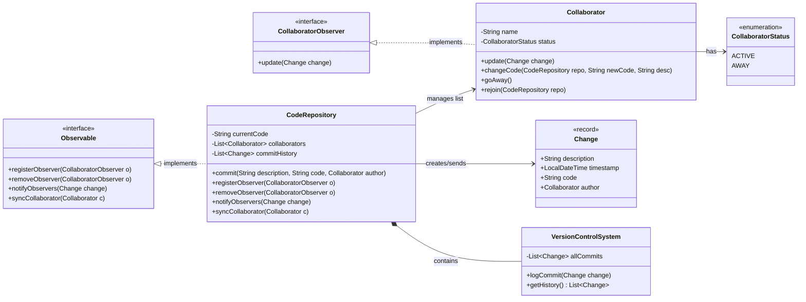

# NOOP - Vježba (Observer Pattern & Version Control System)

Projekt prikazuje primjenu **Observer (Promatrač)** obrasca na primjeru sustava za praćenje izmjena koda u skladištu (`CodeRepository`), uz bilježenje povijesti u `VersionControlSystem`.



## 2. Detaljna obrazloženja zahtjeva (Fokus na Observer uzorku)

### Zahtjev 3: Subjekt (CodeRepository) i registracija promatrača

CodeRepository djeluje kao Observable. U sebi čuva listu registriranih suradnika koji implementiraju CollaboratorObserver sučelje.
Pozivom metode registerObserver() novi suradnik se dodaje u listu preplatnika te dobiva sve buduće obavijesti o izmjenama koda.
Metoda syncCollaborator() omogućuje ponovno sinkroniziranje suradnika koji se vratio u aktivno stanje.

### Zahtjev 4: Promatrač (Collaborator) i sigurna update() metoda

Collaborator implementira CollaboratorObserver sučelje i njegovu update(Change change) metodu.

Sigurnosni mehanizam od kružne izmjene: Unutar update() metode ugrađena je zaštita:
```java
Java
if (change.author().equals(this)) {
    return;
}
```
Ako je suradnik sam autor napravljenog commita, obavijest se ignorira kako se ne bi ponovno okidao vlastiti kod ili stvarale beskonačne petlje obavještavanja.
Pri promjeni stanja putem goAway(), suradnik mijenja status u AWAY, dok kroz rejoin() vraća status na ACTIVE i ponovno se prijavljuje u skladište.

### Zahtjev 5: Notifikacijski mehanizam (notifyObservers)

Kada bilo koji autor pozove changeCode(...), CodeRepository kreira novi Change objekt (s opisom, vremenskom oznakom, novim kodom i autorom).
Nakon spremanja u lokalnu povijest i u VersionControlSystem, poziva se notifyObservers(change).
CodeRepository prolazi kroz listu svih aktivnih observira i svakom poziva update(change), čime se izmjene u realnom vremenu propagiraju svim ostalim članovima tima.

## 3. Službena podjela posla

* **Eli Puljiz:**
  * **Commit:** Inicijalizacija projekta na GitHubu, postavljanje strukture paketnih direktorija (`pckg_model`, `pckg_observer`, `pckg_core`, `pckg_client`) i kreiranje `.gitignore` datoteke.
  * **Commit:** Izrada osnovnih sučelja Observer uzorka (`Observable` i `CollaboratorObserver`).
  * **Commit:** Implementacija središnje klase `CodeRepository` (upravljanje listom suradnika, metoda `commit()` s filtriranjem obavješćivanja autora i zaštitom od rekurzije).
  * **Commit:** Izrada klijentske `Main` klase s cjelovitom simulacijom rada (prijave, odjave i međusobni commitovi).

* **Samuel Puljiz:**
  * **Commit:** Implementacija modela podataka (`Change` record i `CollaboratorStatus` enum).
  * **Commit:** Izrada `Collaborator` klase s logikom za promjenu statusa (`goAway`, `rejoin`) i sigurnom `update()` metodom protiv kružnih poziva.
  * **Commit:** Implementacija `VersionControlSystem` klase za vođenje povijesti commitova i proširenje mehanizma za automatsku sinkronizaciju povratnika.
  * **Commit:** Pisanje i oblikovanje finalne `README.md` dokumentacije s Mermaid dijagramom, obrazloženjima zahtjeva 3–5 i podjelom posla.

